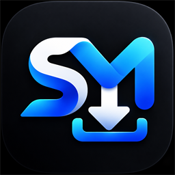

<p align="center">
  
</p>

# SM-SAVE

**download from social media**

A tape-deck styled desktop downloader for video and audio links, built with [Tauri](https://tauri.app/) v2, [React](https://react.dev/) 19, TypeScript and Tailwind CSS v4. Powered by `yt-dlp` and `ffmpeg` under the hood.

## Just want to use SM-SAVE?

You do **not** need Rust, Cargo, Bun, Tauri or any other developer tool. Those are only for building the app from source.

1. Open the **[Releases](https://github.com/Dee-DeVille/sm-save/releases/latest)** page.
2. Download the installer for your system — on Windows, **`SM-SAVE_..._x64-setup.exe`**.
3. Run it, then launch **SM-SAVE** from the Start menu.

`yt-dlp`, `ffmpeg` and `ffprobe` are already packed inside the installer, so there is nothing else to download or install. Everything from here to the "Credits" section is developer documentation and can be ignored.

## Features

- **Tape-deck faceplate** — a single-window deck with a transport readout, segmented level meter and a ruled download ledger.
- **Frameless window** — no native titlebar; minimize, maximize/restore and close keys are drawn into the faceplate, and the casing fills the window edge to edge.
- **Two finishes** — aluminium (light) and graphite (dark), with a rocker switch that remembers your choice.
- **Video or audio** — pick an input mode and a quality; audio is extracted to MP3 at 320 kbps.
- **Playlists** — analyse a playlist, choose tracks, and download the selection at highest / 720p / low quality.
- **Browser sessions** — optionally reuse cookies from a selected browser, or supply a bearer token and referer for private or gated media.
- **Download ledger** — every finished download is logged with title, format, size and time; re-download and open-folder actions are one click away.
- **In-app updates** — the app and the `yt-dlp` sidecar can both check for updates from the footer.

## Download & Installation

Pre-built packages are published on the **[Releases](https://github.com/Dee-DeVille/sm-save/releases/latest)** page:

- 🪟 **Windows (64-bit)** — `SM-SAVE_0.1.0_x64-setup.exe` (recommended) or the **`.msi`** package.
- 🍎 **macOS (Apple Silicon)** — `SM-SAVE_0.1.0_aarch64.dmg`.
- 🐧 **Linux (64-bit)** — the v0.1.0 Linux job failed while unpacking ffmpeg (fixed since), so `.AppImage` / `.deb` arrive with the next release.

### macOS installation note

Because SM-SAVE is an open-source tool without a paid Apple Developer certificate, macOS Gatekeeper may display:

> *"SM-SAVE is damaged and can't be opened. You should move it to the Bin."*

To open it in seconds:

1. Open the `.dmg` and drag `SM-SAVE.app` into your `/Applications` folder.
2. Open **Terminal** and run:
   ```bash
   xattr -cr /Applications/SM-SAVE.app
   ```
3. Open SM-SAVE normally.

## Prerequisites (only for building from source)

Skip this section if you installed a release package — the installer already contains everything.

Before you begin, make sure you have:

1. [Rust and Cargo](https://www.rust-lang.org/tools/install)
2. [Bun](https://bun.sh/) (the project uses Bun for scripts and installs)
3. The [Tauri prerequisites](https://v2.tauri.app/start/prerequisites/) for your operating system

### External binaries (sidecars)

SM-SAVE relies on `yt-dlp`, `ffmpeg` and `ffprobe`. Place the executables in `src-tauri/bin/` before building or running locally. That folder is git-ignored on purpose: the binaries are large and are fetched separately in CI.

Where to get them:

- **yt-dlp** — [yt-dlp releases](https://github.com/yt-dlp/yt-dlp/releases)
- **ffmpeg / ffprobe** — [BtbN/FFmpeg-Builds](https://github.com/BtbN/FFmpeg-Builds/releases) or [ffbinaries](https://ffbinaries.com/downloads)

Tauri requires the target triple in the file name:

**Apple Silicon (M-series):**
- `yt-dlp-aarch64-apple-darwin`
- `ffmpeg-aarch64-apple-darwin`
- `ffprobe-aarch64-apple-darwin`

**Windows (64-bit):**
- `yt-dlp-x86_64-pc-windows-msvc.exe`
- `ffmpeg-x86_64-pc-windows-msvc.exe`
- `ffprobe-x86_64-pc-windows-msvc.exe`

On macOS and Linux, make them executable: `chmod +x src-tauri/bin/*`.

See the [Tauri sidecar documentation](https://v2.tauri.app/learn/sidecar/) for other target triples.

## Run locally

```bash
bun install
bun run tauri dev
```

The Vite dev server runs on `http://localhost:1420`; the Tauri window loads from it.

## Build

```bash
bun run tauri build
```

Installers and the executable land in `src-tauri/target/release/bundle/` (`.msi` / `.exe` on Windows, `.dmg` / `.app` on macOS, `.deb` / `.AppImage` on Linux).

Updater artifacts are signed in CI with `TAURI_SIGNING_PRIVATE_KEY`. For a local build without a signing key, disable them first:

```bash
bun run tauri build --config tauri.build.conf.json
```

with `{"bundle":{"createUpdaterArtifacts":false}}` in that file.

## Releasing

The workflow in `.github/workflows/release.yml` runs on any `v*` tag, builds the app for macOS, Windows and Linux, and attaches the installers plus the signed `latest.json` to the release:

```bash
git tag v0.1.0
git push origin v0.1.0
```

The workflow rewrites the release body and merges a `latest.json` covering every platform it built. The platform URLs in that generated manifest point at `api.github.com` asset endpoints; replacing them with plain `https://github.com/Dee-DeVille/sm-save/releases/download/<tag>/<file>` links keeps the updater free of API-auth quirks. Note that CDN caching can serve a stale `latest.json` for a few minutes after a re-upload.

Two secrets are required for signed auto-updates:

| Secret | Value |
| --- | --- |
| `TAURI_SIGNING_PRIVATE_KEY` | contents of your `sm-save-updater.key` (minisign private key) |
| `TAURI_SIGNING_PRIVATE_KEY_PASSWORD` | its password, if you set one |

The matching public key is already in `src-tauri/tauri.conf.json` (`plugins.updater.pubkey`), and the endpoint points at `https://github.com/Dee-DeVille/sm-save/releases/latest/download/latest.json`. If you rotate the keypair, regenerate it with `bun x tauri signer generate -w sm-save-updater.key` and replace the `pubkey` value.

## Prebuilt Windows installers

`installers/` holds the `.msi` and `.exe` produced from this source at v0.1.0. They are far larger than GitHub's per-file limit for repository uploads, so attach them to a Release instead of committing them (the folder is git-ignored).

## Versioning

The version lives in `package.json`, `src-tauri/tauri.conf.json` and `src-tauri/Cargo.toml`. Bump all three at once:

```bash
bun run bump 0.1.1
```

## Checks

```bash
bun run typecheck   # tsc --noEmit
bun run lint:tw     # Tailwind class conflicts / canonical classes
cargo check --manifest-path src-tauri/Cargo.toml
```

## Project structure

```
src/                     React app (faceplate layout, components, lib)
src/index.css            Tailwind v4 theme tokens and deck utilities
src-tauri/               Rust backend, capabilities, icons, config
scripts/bump.ts          Version bump helper
.github/workflows/       Release workflow
```

## Credits

Made by **Dee** — [@dee.deville](https://www.instagram.com/dee.deville) on Instagram. Source lives at [Dee-DeVille/sm-save](https://github.com/Dee-DeVille/sm-save).

SM-SAVE descends from [VADown](https://github.com/mahmingtea/vadown) by mahmingtea, which is MIT-licensed (stated in its README). The interface, branding, window chrome, bundle identifier (`com.dee.sm-save`), updater endpoint and signing key are all its own; no upstream branding ships in the app.

Full attribution for the upstream project and for the bundled `yt-dlp`, `ffmpeg` and `ffprobe` binaries lives in [NOTICE.md](NOTICE.md).

## License

MIT — see [LICENSE](LICENSE). Third-party components keep their own licenses; see [NOTICE.md](NOTICE.md).
